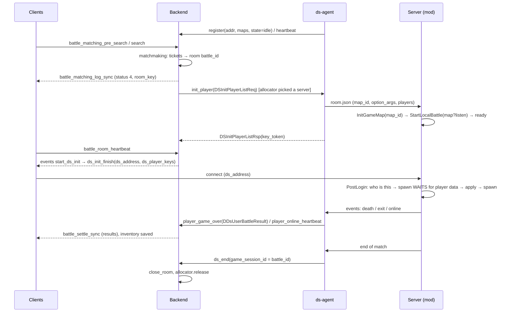

# Match pipeline "listen as dedicated": backend ↔ game server ↔ clients

> **Format reliability.** Not all handlers have been checked against the sniffer. For the DS service (`init_player`,
> `player_game_over`, `ds_end`…) there are **no records at all** in the sniffer captures: this traffic goes between the official DS and their
> backend, the client never sees it — formats are taken only from the proto schema and may not match what the game expects.
> Checked against the sniffer: match and room events (`docs/REF_BATTLE_ROOM_FLOW.md`). Other domains — see
> `docs/HANDLERS_STATUS.md` (column "Format source"; "nothing verified in game"). On an in-game mismatch,
> look here first.

Status: design 31.10; **T1 and T3 done 31.10** (see §6). Goal — a match as on the official DS: the server (a headless game instance with the mod
`DungeonborneRuServer`) is the authority in the raid, the backend is the source of truth about the player before and after the raid, the clients are
ordinary clients. Our TGF logic (loadout, attributes, map, results) goes through the backend, not through LocalDev files.

## 1. Protocol: two DS services, different directions

From `Configure_decoded.txt` / `schema_dump.proto`:

| Service | Where it lives | Who calls | Methods |
|---|---|---|---|
| `tgf.DsRpcService` | on the DS | backend → DS | `hello_world`, **`init_player`**, `heartbeat`, `query_player_game_status`, `player_self_quit`, `player_kickout(_off)` |
| `tgf.DsBattleService` | in the backend | DS → backend | **`player_game_over`**, **`ds_end`**, `player_online_heartbeat/report`, `ds_alias_status_report`, `dsc_status_report`, `create_game_session_result_event`, `game_session_end_event` |

`init_player` — this is the backend handing the whole room to the server:
- `DSInitPlayerListReq { player_data: [DBattleUserData], is_last_one, init_para: DSBattleInitParameter }`
- `DSBattleInitParameter { map_id, user_upper, waiting_timeout, pre_start_timeout, option_args, level_parameter, map_args_datas, rare_pool_current_data, is_stand_alone }`
- response `DSInitPlayerListRsp { key_token: [DsPlayerInitData { ds_user_key, token, encryption_key }] }` → the backend puts
  the keys into `DBattleDSInfo.ds_player_keys` and gives them to clients in the room event `ds_init_finish` together with `ds_address`.

**Currently in `core/backend/src/rpc/handlers/ds_handlers.rs` the direction of `DsRpcService` is reversed:** `init_player`, `heartbeat`,
`query_player_game_status`, `player_self_quit`, `player_kickout*` are written as incoming handlers, but these are outgoing
calls backend → server. The incoming ones from `DsBattleService` (`player_game_over`, `ds_end`, `player_online_*`) are correct.

## 2a. 31.10: how the DS SDK gets data (found in the exe, proto extracted)

The DS SDK is Tencent **g6 dssdk**, a TCP client to the agent "DSA server (ds gate)". Server arguments (exe strings):
`-dsaip=` `-dsaport=` `-starttoken=` `-startmode=`; without `-dsaip` the SDK logs "fail init DsSdk, dsa_ip is empty" and
stays silent (that is why DSA-Probe on 9090 received nothing — the server did not know the address). Embedded proto descriptors
(extraction: scratchpad `pbdesc.py`, 140 files):
- `protocol/pbdesc/ds_gate.proto` (package `ds_gate`): DS → agent `DsGateService` (`RPCG6ProcessReady
  {ds_sdk_version, ds_listen_addr, start_token, start_mode, game_properties map, fake_game_session_id}`,
  `RPCG6ActivateGameSession {ds_user_data map}`, `RPCG6HealthStatus`, `RPCG6ProcessEnding`, `RPCG6Reconnect`,
  `RPCG6TerminateGameSession`); agent → DS `DsSdkService` (`RPCG6ProcessReadyRsp {process_id, trans_service_name,
  trans_service_id}`, **`RPCG6StartGameSession {game_session_id, game_properties map}`**, `RPCG6HealthCheck`,
  `RPCG6ReuseProcess`, `RPCG6TerminateProcess`). `DsStartMode`: 0 Default, **1 LocalDsFakeAllocMode**,
  2 LocalDsWaitAllocMode, 3 LocalDsWaitAllocFleetMode.
- `protocol/pbdesc/ds_service.proto` (package `tgf`): `DSService.DS_RPC_REQ(DSRequest)` / `DS_RPC_RSP(DSResponse)`,
  `DSMsg {head: DSMsgHead, body_bin}`; `DSMsgHead` contains `atframework.RpcRequestMeta rpc_request` (as in the client
  backend protocol), session (service_name, service_id, game_session_id), player_user_id/open_id/zone_id. Application
  calls backend ↔ DS go through this (`tgf.DsRpcService.init_player` …, `tgf.DsBattleService.*`).
- `irpc/codec/irpc/irpc.proto` (package `g6.irpc`): `RequestProtocol {call_type, timeout, request_id, message_type,
  content_type, caller, callee, func, meta}`, `ResponseProtocol {ret, func_ret, error_msg, request_id, …}`.
- irpc TCP frame: header with a magic ("IrpcSplitter::ParseHeader invalid magic_value"), format still unknown —
  will be captured by the first connection of a server with `-dsaip=127.0.0.1 -dsaport=9090` to the backend DSA-Probe.
- Match data: `game_properties` in StartGameSession is JSON of a proto message ("game_properties_string
  JsonStringToMessage", "game_properties_pb Not Found"). The native `UBattleDsUtility::InitPlayerGameData(PlayerState)`
  is called by the hero on possess (ubergraph BP_Tgf_Hero_Default) and currently exits with "LyraPlayerState Has Inited!" —
  the flag is set in advance by our mods (DungeonborneRuClient "Synced PS", LocalDev EquipRemoteClients).

**Checked 31.10 19:37:** the server (listen, `StartLocalBattle`) was started with `-dsaip=127.0.0.1 -dsaport=9090
-starttoken=dbtest -startmode=0` (dbtools.ps1 field `"dsa"`, run.ps1 `-Dsa`) — nobody connected to 9090 before or during the
match, no DS SDK lines in the log. Conclusion: in the client build on a listen server the DS SDK does not initialise even with the
arguments (probably a branch only for `IsRunningDedicatedServer`, cut out of the client build). The native DSA path
is not available to us; what remains is the native `InitPlayerGameData` without SDK data — what it does without it is not checked.

**Checked 31.10 19:39 — native InitPlayerGameData works:** the mods did not set `HasInitedPlayerData`
(DungeonborneRuClient `native_init.txt = 1`, LocalDev equipping postponed `equip_delay_sec=120`), r14=off. The client's hero
on the server has the native manager with 9 items, attributes computed with equipment (MaxHPBase 437, CurHP 697), no
DS module errors. **But the data is of the server's own account** (Noob 10000902: type 400005, career 5, Int 43, Magic 300),
not the client's (10000903, DK 400006): on a listen server the module knows only its own (host) player and gives that to everyone.
**Source found and confirmed (31.10 19:49):** before the match `StartLocalBattle` (native UBattleService) sends
`battle_fetch_battle_user_data` (empty request) and receives **one** `DBattleUserData` (user_key, deploy_preview.
deploy_role: role, backpack, equipped items with affixes) — native InitPlayerGameData applies that to every
PlayerState (data is stored natively in UBattleService, not in reflection). Check: research-backend with
`FETCH_AS_OPEN_ID=76561198000000903` (src/rpc/handlers.rs) gave the server the client's data — the client's hero on the server
Str 37 Dex 18 Sta 15 Int 25, MaxHPBase 557, CurHP 1018, 9 items on the native manager = reference of this DK from a local
match. This is the same format the DS receives for each player (`DsInitPlayerListReq.player_data: Vec<DBattleUserData>`).
Open: serving data PER PLAYER (one request per match; two or more clients get the same set) — before
initialising each client, what native InitPlayerGameData reads must be updated.
Checked 31.10 19:54: there are no `UTGFProtoTgfDBattleUserData` objects in server memory after StartLocalBattle — the data
is stored as a C++ protobuf inside UBattleService and cannot be substituted from Lua/UE4SS.
Checked 31.10 19:59 (server + clients F: and E:): `battle_fetch_battle_user_data` — once at match start;
no repeated request when clients join; both client heroes got the server account's data (wizard, Int 43,
HP 697). In total: on a listen server native InitPlayerGameData can only do "one data set per match" — for
several players with different roles the native path will not do (outside DSSDK, which does not start on listen).
Checked 31.10 20:14: map via `open <map>?listen` (run.ps1 `-InitMap open`) instead of StartLocalBattle —
`battle_fetch` is not sent, native InitPlayerGameData equips the hero with the test template `type=499999 race=0 career=0`
(Str 8 Dex 6 Sta 4, HP 150, 9 default items). Without match data the native path takes a stub — does not help.
**31.10 experiments on "data per player"** (research-backend, environment variables in src/rpc/handlers.rs):
- (a) re-sending `SCBattleFetchBattleUserRsp` to the server after match start — as a push (req_seq=0) and as a repeated response to
  the seq of the original request (`FETCH_PUSH_OPEN_ID/AFTER_SECS/MODE`): **ignored**, the client's hero has the server's data.
  UBattleService accepts data only as a response to its own pending request.
- (b) repeated `BattleService:StartLocalBattle` in the middle of a match (command `relaunch` in dbserver-control.txt,
  `FETCH_SEQUENCE=self,<open_id>`): the game **sends battle_fetch again**, but **reloads the map**; after the reload
  both the host (now with its own pawn) and the joined client get the second set (DK, Str 37 / HP 1018). The repeated request
  cannot be separated from the match reload — not usable for different players in one match.
- (c) LocalDev equipping (the HasInitedPlayerData flag is set by mods, on the server without the stub, r14=off): the client's DK —
  Str/Dex/Sta/Int/Wil/Fai = 30, MaxHPBase 100, CurHP 100, 9 items on the native manager (reference: 37/18/15/25/6/6,
  557, 1018). The reasons are visible: the client's PlayerState has user_id=0 (apparently set by the native initialisation) → LocalDev
  takes the shared client-loadout.txt without role attributes ("RoleAttrs written 0"); equipment gives no bonuses (CurHP =
  base) — the items are equipped "past" the native calculation path.
- localthen (run.ps1 `-Match localthen`: the client first does StartLocalBattle itself — its fetch gets ITS OWN data —
  then open to the server): the client's hero on the server still has the server's data. Client data does not reach the server.
- **Native path vs LocalDev comparison for the same DK** (server probe: PS, ASC; copies `dbtools\probe-native.txt`,
  `probe-localdev.txt`): the same — PawnData HeroData_HeroSample, HasInitedPlayerData, 4 GE (GE_IsPlayer,
  GE_PlayerAttr_DisengageEffect / FullHPEffect / Recover_HeroPerSec), 53 abilities, 9 items on one manager.
  Different: PlayerState `MyUserID/MyRoleGuid/MyOpenId` — native 10000903 / 1000090301 / LOCAL_GAME_MODE_OPENID,
  LocalDev 0 / 0 / empty; attributes — native Str 37 … MaxHPBase 557 CurHP 1018, LocalDev all 30, HP 100/100.
  Equipment bonuses do not go through GE (GEs are the same) — the game computes them from role/item data; with zero player
  and role ids the calculation is not done. Next: in LocalDev set the player/role/open_id ids before equipping and feed
  the role attributes from this player's file — compare with the reference.
- **31.10 evening, bringing LocalDev up to the reference:**
  - Identification: the client connects with `?OpenId=<steam id>` (native format `%s?OpenId=%s?token=%s`) — the server itself
    sets PS.MyOpenId; LocalDev takes `client-loadout-<uid>.txt` and sets MyUserID/MyRoleGuid. Checked.
    (dbclient: `run\dbclient-urlopts.txt`.) Native InitPlayerGameData on listen overwrites it with LOCAL_GAME_MODE_OPENID.
  - Stats 30 were caused by the research backend (loadout without the 11th field). With the main one: role base = reference
    (Str 23 Dex 8 Sta 9 Int 19 Wil 6 Fai 6, MaxHPBase 557).
  - Item reference on the server (`dbtools\items-native.txt`): each item has 3–4 EquipAttrItems rows, the owner's RoleGuid,
    AttrParseType 2/1 for hands; bonuses are written into the base (Base=Cur=37), HasAdded=false. Arithmetic:
    stat = role base + sum of item bonuses; MaxHP = 557 × (1 + ΣMaxHealthPercent 0.828) = 1018.
  - With LocalDev EquipAttrItems = 0 right after equipping; the equipped object is a copy (not the one LocalDev created).
    OnRep_DItemBuffer on the server does NOT build the list (same in loot-native-readback.tsv PrivateLoot). The DItem bytes hold
    the attribute id and the roll (e.g. 1001 → 5635), the value (10) is computed by C++ from tables. Only native
    item creation (LoadUserDataFromCache) builds the list.
  - HP: GE_PlayerAttr_FullHPEffect with LocalDev is not applied to the new maximum (ordering).
  - Experiments (LocalDev.lua, settings.txt `equip_attrs=1` / `reequip_test=1` / `reinit_test=1`):
    - GetAffixDisplayConfig rows (C++ computes from bytes) = native EquipAttrItems 1:1: Location 1 → EquipAttrItems,
      3 → HoldAttrItems; id 2004 → Chest/Trousers/HelmetDefGearLevel by slot (gloves/boots have none), in hand
      1101/1120/2004/2006 → Right*. FGameplayAttribute references — ASC:GetAllAttributes (150). Filling gives exactly
      the native counts (3–4, hold 5/5/3); the copy made on equip carries the lists over.
    - these do NOT apply the bonus: ExchangeEquipToInventory (false/true), UpdateEquipInstance, SetEquiped, SetHeld,
      unequip/equip, InitDefault (resets MaxHealthBase to 100), InitFirstLevel, SetInitAttribute;
      ResetInitAttribute sets HP as an absolute value (1.0 = 1 HP).
    - native path: RemoveEquipBySlot subtracts the item's bonuses from the base immediately (trousers: Str 37→33, MaxHP% 0.828→0.676,
      HP 1018→933); RemoveEquipToInventory + back — stats do not change.
    - conclusion: native C++ applies the bonus on load (LoadUserDataFromCache) directly into the base; unequipping subtracts by
      EquipAttrItems. So the correct way: fill the lists with native values + add them to the base once.
  - **31.10 23:xx — alternative found: native UI operations in the match (`UItemFunctionLibrary` on the hero).**
    Native path: `ExchangeItemToInventory` (unequip to backpack) subtracts the item's bonuses (one tick later), `ExchangeItemToEquipment
    WithSlot` (Source{Type=1, item FROM the backpack — this is a new object}, SourceEquipment=nil) adds them. Low-level
    manager calls (ExchangeEquipToInventory, RemoveEquipToInventory) do not touch stats. HP after an item change
    recovers via the native GE_PlayerAttr_Recover_HeroPerSec.
    LocalDev (`equip_attrs=1`): item → FillAttrLists (native display rows) → RoleGuid → `AddItemInstanceWith
    AutoStack` into the backpack → IFL equip. Result after 0.5 s: **Str 37 Dex 18 Sta 15 Int 25 MaxHPBase 557 = reference**;
    MaxHealthPercent 0.765 (reference 0.828: missing 0.063 from InitFirstLevel, LocalDev calls it before equipping); CurHP 100.
  - 23:40: backpack — `AddItemInstanceWithPosition` does not put the item, `AddItemInstanceWithAutoStack` does (AllItems=2), backpack
    items get FillAttrLists by slot `IFL:FindBestEquipSlotForItem`. InitFirstLevel is additive and computes from the CURRENT
    primary stats: after items +0.105, native +0.063 = from the role base → call after ApplyRoleAttrs, before equipping.
    HP: CurHealth is 100 and does not grow within 2 s; added GE_PlayerAttr_FullHPEffect 0.5 s after equipping (not checked).
  - **23:44: client crash (R14, 0x142f602c6) is not related to LocalDev actions:** with equip_delay_sec=6 LocalDev did nothing,
    and the client crashed 5 s after connecting. On the native path (native_init=1, native InitPlayerGameData
    ran) the client survives. I.e. the crash is caused by skipping native InitPlayerGameData (the HasInitedPlayerData flag is set by mods in advance).
  - Not done yet: +0.063 MaxHP%, HP top-up/recovery, backpack ("b" items: AddItemInstanceWithPosition does not put,
    AutoStack does), client crash in LocalDev mode (the hero disappears before +2 s).
  - In LocalDev mode the client crashes in the first 1–3 s (R14), on the native path it lives 15+ s — LocalDev equips after
    the client connects, the native path before. The LocalDev backpack is not filled (BagAdded=2, AllItems=0).
A reference for our own equipping exists: the same DK from the native path — Str 37 Dex 18 Sta 15 Int 25, MaxHPBase 557,
CurHP 1018, 9 items on one manager.

## 2. Transport: why ds-agent is needed

Officially the DS is linked to the backend through the Tencent DS SDK (`UDSSDK`/`UDssdkSubsystem`, `GRomeLinkDSServer.dll`, DSA agent).
Probe 31.10: DS SDK objects are alive in the server process, but nobody connected to `DSA-Probe` (9090) — without the DSA agent
and its arguments the SDK stays silent. Options:

- **N — native.** Emulate DSA/GRome so that `UDSSDK` itself accepts `init_player` and sends `player_game_over`.
  The protocol is unknown; research: strings/exports of `GRomeLinkDSServer.dll` (not packed), UHT headers of `DSSDK`.
- **B — bridge (recommended for now).** Next to each server — a `ds-agent` (sidecar on the server machine):
  - ds-agent ↔ backend: own channel (HTTP/JSON or TCP), **but the messages are the same proto** (`DSInitPlayerListReq`,
    `DSPlayerGameOverReq`, `DSDsEndReq`…). Moving to N later changes only the transport, not the backend.
  - ds-agent ↔ mod: files in the instance folder (`-dbroot`, like `run\` now): Lua in UE4SS has no sockets.
    The mod can already do: role, status, commands via `<role>-control.txt`, probes.

## 3. Stages and data flows

| # | Stage | Data | Owner of truth |
|---|---|---|---|
| S0 | Server pool | ds-agent: address, maps, state (idle/initializing/battling/draining) | allocator |
| S1 | Match | tickets (solo/party), `level_id` → `map_id` (`matchmaker::get_map_config`) | matchmaking |
| S2 | Allocation + `init_player` | `DBattleUserData` of each player + `DSBattleInitParameter`; **raid snapshot** (item guids at entry) | backend |
| S3 | Server initialisation | `room.json` → `InitGameMap` (fixes loot by `map_id`, BACKLOG "Loot"), map start | server |
| S4 | Player join | spawn gate: the pawn is created only after the player data is applied (like Lyra `PlayerCanRestart`, like TGF waiting room / `IsRoomReady`) | server |
| S5 | Raid | death, exit, online → `player_game_over` per player (equipped, backpack, small backpack, experience) | server → backend |
| S6 | Results and end | loot sale calculation (`settle_extraction`) from the S2 snapshot, results push; `ds_end` closes the room | backend |

Rules:
- **One `DBattleUserData` builder** (`build_battle_user_data`) for both `battle_fetch_battle_user_data` (local match)
  and `init_player` (DS). Class attributes, loadout, deadmoney kit — there too, not in LocalDev.
- **Raid results in DS mode — only from the server** (`player_game_over`). The client `report_action` (LocalSettle/
  PrivateRaid status 2/3) in a room with a DS does not change the inventory (currently the client snapshot overwrites equipment — BACKLOG "Affixes").
- **Idempotency:** a player's result is applied once per `(battle_id, user_id)`; `ds_end` and `release` are repeatable.
- **End-to-end id:** `battle_id` in backend, ds-agent and mod logs.
- **`client-loadout*.txt` files in `RebuildProbe`** — only for the old listen; not written in DS mode.

## 4. Backend tasks

| Task | Where | Essence |
|---|---|---|
| T1 DS module | `core/backend/src/ds/` (`battle_service.rs` incoming, `rpc_client.rs` outgoing, `agent_link.rs`) | reverse the direction of `DsRpcService`; remove the "responses" to `init_player`/`heartbeat`/… from the handlers |
| T2 Allocator | `core/backend/src/lobby/allocator.rs` | pool from ds-agent registrations instead of the static `DS_POOL`; states, TTL, health by heartbeat |
| T3 Room state machine | `core/backend/src/lobby/matchmaking.rs`, `lobby_handlers.rs` | Matched → DsInit (`start_ds_init.end_timepoint`) → DsInitFinish (after the `init_player` response) → Battling → GameOverSettle → Closed; `battle_room_heartbeat` reads the state instead of making it up |
| T4 Player data | `raid_handlers.rs` / `battle_handlers.rs` | one `build_battle_user_data`; raid snapshot at S2 |
| T5 Results | `ds/battle_service.rs` + `settle_extraction` | `player_game_over` = authoritative path; loot sale from the S2 snapshot; idempotency |
| T6 Identity | `ds/` | `ds_user_key` ↔ `user_id` ↔ `open_id`; player tokens per room |
| T7 Disable the file channel | `raid_handlers.rs` | `write_client_loadout_file` only outside DS mode |
| T8 Observability | everywhere | `battle_id` in every stage log; `rpc_dump` for DS messages |

Outside the backend (for completeness): **ds-agent** (new crate: registration, start/restart of an instance via DbTools or
natively on Hetzner, room files, event forwarding) and the **mod** (`room.json` → `InitGameMap`/start, spawn gate,
applying player data, result events).

## 6. Done 31.10 (T1 + T3)

- **T3 room state machine** — `core/backend/src/lobby/matchmaking.rs`: `RoomStage` WaitingServer → DsInit (server assigned) →
  DsReady (`set_ds_ready` with keys); `take_init_requests`/`retry_init` for the driver; `DsKey`, `ds_key_of`.
  `start_direct` (private rooms), `close_room`, `room()` — previous entry points kept.
- **Match room per reference** — `lobby_handlers::lobby_battle_room_heartbeat`: events 1–4 (`startDsInit` →
  `dsInitFinish` → `startLoading` → `startBattling`) one push per heartbeat, what was sent is remembered by
  (battle_id, open_id); before DsReady the client gets only `startDsInit` and waits; participants have `ds_player_key`.
  Without a room in the matchmaker (LocalDev/listen) — all 4 events are available at once, as before, but one at a time.
- **T1 module `core/backend/src/ds/`** — `agent_link` (HTTP for ds-agent), `rpc_client` (outgoing `init_player`),
  `driver` (every 1 s: for rooms in DsInit — `init_player`, response → DsReady; no agent → fallback mode with keys
  open_id/"1001"; 3 failures → fallback mode with a loud log). `ds_handlers.rs`: incoming `init_player` now
  logs a warning. `allocator::register` — a server from the agent goes into the pool.
- Checked: `cargo build` clean (except 2 old warnings), `cargo test` 28/28 (new: hex, option_args, room
  stages); HTTP smoke check (register, event hello_world, init_player rejected via event, reply 410, next 204).
  ds-agent is not written yet — currently always fallback mode.
- **Checked in game 31.10** (automated run `dbtest\run.ps1 -Match native`, no human): the full native match —
  StartMatch → pre_search/search → room → `matched` (CAN_JOIN_IN) → room events 1–4 → FINISHED → the client itself
  connected to the server on `dsInitFinish`. For that the driver **pushes** room events to each online player every 1 s
  **by itself** (`pump_room_events` → the same `lobby_battle_room_heartbeat` → `hub::push_raw`): the reference sends them unrequested,
  without them the client does not go to `battle_room_heartbeat`. The event number is claimed atomically (`room_sent_claim`) —
  the driver and the client heartbeat do not duplicate.

### Native raid result: dbnative → `POST /ds/player_result` (02.11)

The server is the authority: the native `UBattleDsUtility` chain on death, exit and leave takes the pawn's inventory into the player's
`DBattleUserData` record; at status 3 dbnative sends it here (ds-agent HTTP, 127.0.0.1:9091). Code —
`core/backend/src/rpc/handlers/raid_native.rs`, check — test `native_result_applies_once` on a real snapshot,
manual sending — `tools/py/player_result.py`.

- **Entry:** `GET /ds/battle_user_data?open_id=` writes `state.raid_entry` {token, role_guid, guids, applied:false} for the player
  and puts the token into `ds_player_key.ds_token` of the issued record (re-issuing the same role before the result — same token).
- **Result:** `POST /ds/player_result?open_id=<real OpenId>&status=<EnDSPlayerGameStatusType>&reason=<EnDSPlayerActorStatusType>`,
  `Content-Type: application/x-protobuf`, body — `SerializeToString` of the record (like the probe's `gameover-*.bin`).
  Or JSON `{open_id, status, reason, payload_hex}`. The probe codes are these: status 2 JOIN / 3 GAMEOVER;
  reason 1 SELF_QUIT, 2 DEAD, 3 ESCAPE, 4 ALIVE, 11–17 failures.
- **Response:** 200 `{ok:true, applied: extraction|death|self_quit|kept, …}`; 400 — not GAMEOVER / cannot parse;
  404 — no player; 409 — nothing issued, result already applied, role or token mismatch. A repeat is safe (409), send
  once at status 3, on a network error — retry.
- **Decision:** ESCAPE/ALIVE — role inventory = result, loot carried out in bags is sold (`settle_extraction_items`);
  DEAD/SELF_QUIT — equipped items and backpack are lost, the small backpack stays, then deadmoney may give the stage kit
  (`dm_after_death`, after clearing); failures — items as before the raid. Experience — `raid_finish_exp`. Items with a guid that already
  lie in the stash or with another role and were not issued into the raid are discarded (duplicates).
- **Needed from dbnative:** the record under the real OpenId (`realkey` in `native_data.txt`), POST on the transition to status 3.
  Done 02.11 (not checked in game): `realkey` — in the 2nd line of `native_data.txt` of the Steam install (server);
  dbnative `op=goreport` (mgr, key, url) — SerializeToString of the record → POST, copy `gameover-<key>-post-*.bin`;
  DungeonborneRuServer (`SendResults`) calls it at status 3 of a record with a real OpenId, retries on network/5xx up to 10 times,
  log `[RAIDRESULT]` in `dbserver.log`. The probe (`dbserver-gameover-probe.txt` = 0) turns off only its own hooks and lines.
- **Rejoin (02.11):** the native join refusal (`PreLogin` → "Player Game Status Invalid", docs/ghidra_gameover)
  is turned off on listen. DungeonborneRuServer `JoinGuard` once a second goes through remote controllers with a live
  connection (the game gives a returning player the old PlayerState and controller — keys based on them do not work) and sends to the lobby
  (`ClientTravel` to RuinedCrypt_03, the way the client leaves after the portal; if the connection is still alive after 5 s — the server closes it:
  `ClientWasKicked` + controller removal):
  without OpenId (console `open ip`); an OpenId whose result was taken more than 10 s ago (`dbserver-rejoin.txt` = 1 — let in and
  send a new result); a second live connection of the same OpenId. A second result is not sent when forbidden. Log
  `[JOINGUARD]`. OpenId — from the connection address (`UNetConnection::RequestURL`, not in reflection — dbnative
  `op=connurl` finds the connection's FString that starts with `/` and contains `?`), otherwise `MyOpenId` (3 checks without it).
  Checked 02.11 11:21–11:28: exit via portal → three joins with the same OpenId (new IpConnection, PC/PS the old ones) and
  a console `open` without OpenId — all sent to the lobby (`ok=true`), the server did not need to close the connection,
  the client does not crash. Not checked: the death path, a modified client ignoring `ClientTravel`.
- **`&token=`** — dbnative adds `token` from the connection address (native format `%s?OpenId=%s?token=%s`) to
  `GET /ds/battle_user_data` (RuClient passes the player connection's `conn=`). Verification — on the backend (missing/wrong → refused,
  without data the player is not initialised). The dbtest address (`dbclient-urlopts.txt`) has no token — it is not added.
  Backend (02.11): the room token is random per player and room (fallback mode without ds-agent; it used to be a shared "1001",
  `ds/driver.rs fallback_key`), the client gets it in `ds_init_finish`. `battle_user_data` checks `&token=` against the token
  of the player's room (`matchmaking::token_of`): wrong → 403 `bad_token`; no `&token` — allowed in local mode
  (dbtest), strict (`[auth] require = "relay"` or `DS_REQUIRE_TOKEN=1`) → 403 `token_required`; a token without a room
  in strict mode → 403 `no_room`. The verified token becomes the token of the match record (`ds_token`) and of the result — one for the whole chain.
- **`&session=<pid>-<process start time>`** (one server process — one raid) dbnative adds to
  `GET /ds/battle_user_data` and `POST /ds/player_result` — so the backend can refuse (409) whoever already had a result applied in this session.
  Backend (02.11): the session is stored in `state.raid_entry.session`; `battle_user_data` with the same session after an applied
  result → 409 `{"error":"raid_finished"}`; `player_result` from a session other than the issuing one → 409.
  Since 03.11 the server process runs several raids in a row (reset below): on each reset dbnative `op=newsession`
  sets `session=<pid>-r<epoch>`, otherwise a player of the previous match would get 409 in the next one.

### Server reset between matches (M3, 03.11)

One server process — many matches. A slot in the allocator: `free / busy / resetting / dead`; a closed room (all
results, `ds_end`, TTL, offline, a participant went into a new search) moves the slot to `resetting`, not to `free`.

| Side | What it does |
|---|---|
| backend | `POST /ds/player_result` on the last result (and on a 409 repeat while the slot is in resetting) returns `"room_closed":"<battle_id>"`; the player gets `battle_room_log_sync` gameOverSettle + finish (otherwise the client itself goes back to the server — native recovery into the match) |
| RuServer mod | heartbeat `POST /ds/slot` every 10 s from the start phase: `{port, slot, phase: hosting/ready/resetting/ended, epoch, players, ws_mb, private_mb, map}` → `{action: none/reset, battle_id?}` |
| RuServer mod | on `room_closed` or `action=reset`: those remaining → to the lobby → after 5 s reset the mod state (JoinGuard, results; UBattleDsUtility records are taken as the baseline — they survive a map reload) → `epoch = os.time()`, `newsession` → `StartLocalBattle(<map>?listen)` → observer → `ready` |
| backend | the slot is `free` again on `phase=ready` and epoch ≠ epoch at closing time (lower — the process was restarted); no heartbeat for 60 s — `dead` (no rooms given, the first heartbeat revives it); a slot that never sent a heartbeat (old mod) is released immediately |
| backend | the room is closed: results from everyone; a participant without a gateway connection for longer than `DS_ROOM_OFFLINE_SECS` (default 0 = off: a disconnected player holds the room until the end of the match, 03.11); a participant joined a new search/room; `DS_ROOM_TTL` (45 min). For a closed room the client heartbeat gets only gameOverSettle + finish. battle_ids are unique across backend restarts (numbers from the start time) |

`-dbslot=ip:port` — the slot address as in `DS_POOL` (optional; otherwise the backend looks up by sender IP and port).
Debugging: `GET /ds/slots`. Check: `dbtest\resetcycle.ps1 -Rounds 3` (server + client via native match, exit,
reset, the same player in the next match). 03.11 10:30: 3/3, reset 23–26 s.

Do not: delete the PC/PlayerState/pawn of a player without a connection — the game keeps them for reconnection; after deletion
the reconnecting player gets a PC without PlayerState and the server crashes (AV, 03.11 10:04).
Memory: private grows ~50 MB per match, handles ~150 per match (3 matches) — long runs need a planned
process restart (after N matches; a service on the machine must start it again, see CI_CD_PLAN §4.4).

### HTTP for ds-agent (`DS_AGENT_BIND`=127.0.0.1, `DS_AGENT_PORT`=9091)

| Request | Body / response |
|---|---|
| `POST /ds/register` | `{agent_id, ds_address, maps?}` → `{ok}`; the address goes into the allocator |
| `GET /ds/next?agent_id=` | long poll up to 20 s → `{cmd_id, battle_id, method, payload_hex}` or 204 |
| `POST /ds/reply` | `{cmd_id, payload_hex}` or `{cmd_id, error}`; 410 — the command is no longer waiting |
| `POST /ds/event` | `{agent_id, method, payload_hex}` — DsBattleService methods only → `{type, payload_hex}` |
| `GET /ds/agents` | debugging: agents, queues, pending responses |

An agent that has not polled for > 60 s gets no commands. `payload_hex` — bytes of the same proto as the native DS
(`DSInitPlayerListReq`/`Rsp`, `DSPlayerGameOverReq`…).

## 5. Open questions (checked by automated runs of `tools\stand\run.ps1`)

1. With what URL and token the client connects on `ds_init_finish` (native match button — BACKLOG "Lobby", paused:
   `search` is not sent). Whether the server checks the token.
2. Can `UBattleDsUtility.InitPlayerGameData(PS)` take data without the DS SDK, or should the loadout/attributes be applied by our own code
   (like LocalDev `EquipRemoteClients`).
3. How to hold the spawn until data arrives: `PlayerCanRestart`/TGF waiting room (`IsRoomReady`, `RoomReadyDelegate`) or our own gate in the mod.
4. Path N: DS SDK launch arguments and the GRome protocol — separate research.

### Who killed whom (03.11, deadmoney: currency 1012 for killing a player)

On a "death" result (record status 3, reason 2) the server mod reads the native statistics
`ALyraPlayerState.RelationIntStatistics.RelationIntStatistics` (`{Type, OpenID, Value}`, type
`TgfActorRelationStatisticType`: 3 Kill, 4 BeKilled): the victim has BeKilled = killer's OpenId, the killer has Kill = the victim's
OpenId. A player killer (numeric OpenId, not the victim themself) → `POST /ds/kill {"killer","victim","battle_id","session"}`,
once per victim per raid; log `[KILL]` with all statistics. The hook on
`UTgfControllerSteamAchievementComponent::OnPlayerKillEvent` (Lyra.Elimination.Message) does not fire on the server.
Only "death by self" checked (statistics empty, no POST); PvP — not checked.

### Reset and host — fixes after a live test (03.11 15:00)

- **Reset without kicking out.** `ClientTravel` "to the lobby" right after the result cut the connection before the client got "match
  over", and the client reconnected by itself (native branch 0x145993920) into the reloaded hall. Now the mod waits for
  clients to leave on their own; after 30 s those remaining get `ClientTravel` to the lobby (not `ClientReturnToMainMenuWithTextReason`:
  it went through the start menu, and there was no own hero in the hall — live test 16:13); reload when there are no connections,
  or after 60 s. `ULocalPlayer` (host) connections are not counted as players (reset, JoinGuard).
- **Host team 254** (dbnative `setteam`, every 5 s; the client mod hands out 1..253 to players) — the host is no longer
  the first player's teammate in the HUD. The host's pawn is re-hidden every 5 s.
- **Late observer** (experiment, `dbserver-observer.txt` with the word `late`, e.g. `late spec destroy`):
  right after the map — quit/hide/freeze, 5 s after the first player joins this map — the steps from the file
  (`bOnlySpectator` + `DestroyCharacter`; `StartSpectatingOnly` cannot be called from Lua). hostflow run 2/2: mobs
  spawned and stay (30–69 characters), no crashes; room population as the player moves is not checked.

### Spawn points per map (census 03.11, `tools\stand\startscensus.ps1`, mod `[STARTS]` lines)

`ALyraPlayerStartSet` sets (set = team), each with **3 starts**. `GameSession.MaxPlayers = 20` on all maps.
"Hall" — sets with `bWaitingPointSet` (points for moving from the hall/teleport into the hall, not for spawning teams in a match).
`LevelArgs` — the set is active only with this map option (`dynamic_option_args`: count 1/2/3 → `1010101/02/03` for 10101,
`1010201/..` for 10102, `1020101/..` / `1020201/..` for the castle): only **solo** has extra sets.

| Map | Starts | Match sets always | Match sets solo only (LevelArgs) | "Hall" sets | Set groups |
|---|---|---|---|---|---|
| L_Dungeon_Official_01 | 96 | 16 | 4 (`1010101`) | 12 | 8 |
| L_Dungeon_Official_01_Classic | 96 | 16 | 4 (`1010201`) | 12 | 8 |
| L_Dungeon_Official_01_Hard | 96 | 16 | 4 (`1010201,1010101`) | 12 | 8 |
| L_GothicCastle_WP_Main | 51 | 8 | 6 (`1020101`) | 3 | 0 |
| L_GothicCastle_WP_Main_Classic | 51 | 8 | 6 (`1020201`) | 3 | 0 |
| L_GothicCastle_WP_Main_Hard | 48 | 8 | 5 (`1020201,1020101`) | 3 | 0 |
| L_Dungeon_Matching_01 (hall) | 54 | 18 | — | — | 0 |
| L_GothicCastle_Matching (hall) | 60 | 20 | — | — | 0 |

Conclusion for the matchmaker (teams ≤ match sets, players ≤ 20): dungeon — solo 20, duo 10 teams (20 players),
trio 6 teams (18); castle — solo 14 (Hard 13), duo 8 teams (16), trio 6 teams (18). What the game does if there are more teams
than sets — not checked.
